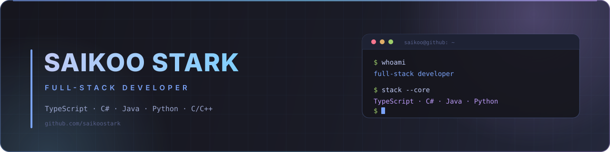

  

  

  

## About

Full-stack developer with a backend bias. I care about the parts users don't see:
clean API contracts, authentication that holds up, and data that stays consistent
when things go wrong.

I've built with TypeScript, C#, Java, and Python, and I started with C, shell, and
systems fundamentals through ALX. Currently building **MiCurso**, an e-learning
platform backend with NestJS, PostgreSQL, and Redis.

| | |
| :-- | :-- |
| 🔭 **Currently** | Building **MiCurso** — and experimenting with LLM-powered developer tooling |
| 🧠 **Interested in** | Distributed systems, event-driven design, and developer tooling |
| 🧰 **Daily drivers** | TypeScript · C# · Java · Python · C/C++ |
| 💬 **Ask me about** | API design, auth, databases, or debugging a segfault |

## Tech Stack

**Languages**

  

**Backend & APIs**

  

  
  
  

**Frontend**

  

**Data & Tooling**

  

  
  
  

## Featured Projects

| Project | What it does | Built with |
| :-- | :-- | :-- |
| **[MiCurso Backend](https://github.com/saikoostark/mi-curso-backend)** | E-learning platform API with JWT + rotating refresh tokens, attribute-based authorization, audit logs, rate limiting, and health/metrics endpoints. | `TypeScript` `NestJS` `PostgreSQL` `Redis` |
| **[Notify Hub](https://github.com/saikoostark/notify-hub)** | Real-time notification hub with authentication, channels, messages, FCM push notifications, and an admin dashboard. | `Next.js` `React` `TypeScript` `Firebase` |
| **[My Ecommerce App](https://github.com/saikoostark/my-Ecommerce-App)** | Full-stack storefront with product/category admin, cart, orders, and cookie-based authentication. | `C#` `ASP.NET Core MVC` `EF Core` `SQL Server` |
| **[Orders & Notifications](https://github.com/saikoostark/OrdersAndNotifications)** | Order management with simple and compound orders plus asynchronous notification queues. | `Java` `Spring Boot` `Maven` |
| **[simple_shell](https://github.com/saikoostark/simple_shell)** | A Unix shell implementation with command parsing, PATH resolution, built-ins, and process control. | `C` `Linux` `POSIX` |

### More work

- **[SmartOCR](https://github.com/saikoostark/SmartOCRSelection)** — anonymous Arabic/English OCR for scanned PDFs and images · `Django` `PaddleOCR` `PDF.js`
- **[ProjectsGenerator](https://github.com/saikoostark/ProjectsGenerator)** — an LLM framework that turns vague ideas into rigorous, production-grade project specs
- **[Bank System](https://github.com/saikoostark/Bank_System)** — a C++ OOP banking simulation with accounts, clients, and savings accounts

## GitHub Activity

  

  
  

  <picture>
    <source media="(prefers-color-scheme: dark)" srcset="https://raw.githubusercontent.com/saikoostark/saikoostark/output/github-contribution-grid-snake-dark.svg" />
    <source media="(prefers-color-scheme: light)" srcset="https://raw.githubusercontent.com/saikoostark/saikoostark/output/github-contribution-grid-snake.svg" />
    
  </picture>

## Connect

I publish everything here. If something catches your eye, open an issue — I'm always up for a technical conversation.

  
  

  

